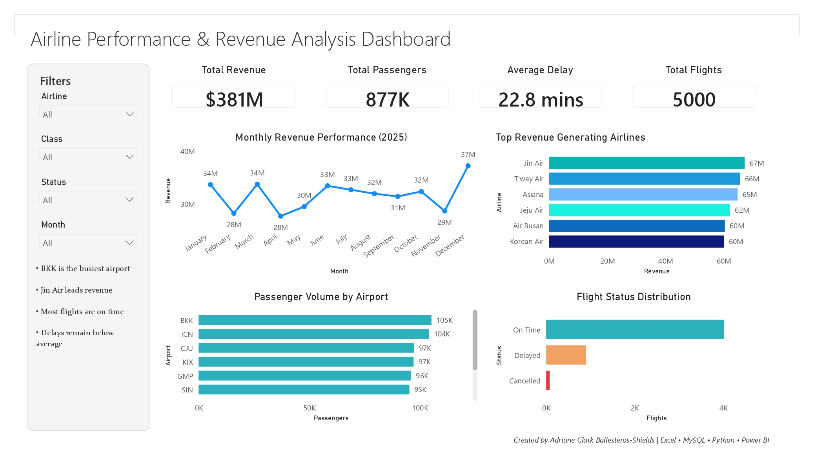

# ✈️ Airline Performance & Revenue Analysis Dashboard
---

## 📸 Dashboard Preview




---
# ✈️ Airline Flight Data Analysis

An analysis of 5,000 flights operated by six airlines in 2025, covering revenue, ticket pricing, passenger volumes, routes, delays and cancellations.

---

## 🎯 Project Overview

This project explores airline operations data to answer five questions:

1. How much revenue do the flights generate, and what drives it?
2. How do airlines, travel classes, routes, airports and months compare?
3. How common are delays and cancellations, and what affects them?
4. Is the flight status data reliable?
5. Where are the biggest opportunities to improve revenue and punctuality?

---

## 🗂️ Dataset

| Item | Details |
|---|---|
| Records | 5,000 flights (about 13.7 per day) |
| Period | 1 January 2025 – 31 December 2025 (365 days) |
| Airlines | Jin Air, T'way Air, Asiana, Air Busan, Jeju Air, Korean Air |
| Airports | 9: ICN, GMP, PUS, CJU (Korea), KIX, NRT (Japan), BKK (Thailand), SIN (Singapore), MNL (Philippines) |
| Routes | 72 unique departure–arrival pairs |
| Classes | Economy, Premium Economy, Business |
| Status | On Time, Delayed, Cancelled |

**Columns:** `FlightID`, `FlightDate`, `Airline`, `DepartureAirport`, `ArrivalAirport`, `Class`, `Passengers`, `TicketPrice`, `DelayMinutes`, `Status`, `Revenue`.

There are no missing values or duplicate records. `Revenue` equals `Passengers × TicketPrice` in every row, and no flight departs from and arrives at the same airport. The currency is not specified in the data.

---

## 🔧 Approach

1. **Validation:** checked missing values and duplicates, tested whether revenue matches passengers × price, and tested whether `Status` agrees with `DelayMinutes`.
2. **Feature creation:** added month, quarter and weekday, route (departure–arrival), and a domestic flag (both airports in Korea).
3. **Exploration:** compared revenue, price, passengers, delays and cancellations by airline, class, airport, route, month and weekday.
4. **Statistical testing:** Kruskal–Wallis tests for numeric comparisons, chi-square tests for categorical ones and Spearman correlations, using a 5% significance level.

**Tools:** Python (pandas, SciPy).

---

## 📊 Key Findings

### Headline numbers

| Metric | Value |
|---|---|
| Total revenue | 380.7 million |
| Passengers | 876,930 (average 175 per flight) |
| Average revenue per flight | 76,150 |
| Average ticket price | 431.8 (range 60 – 800) |
| Revenue per passenger | 434.2 |
| Flights marked On Time / Delayed / Cancelled | 4,016 (80.3%) / 903 (18.1%) / 81 (1.6%) |
| Flights with any delay (> 0 min) | 78.0% |
| Flights delayed by 15+ minutes | 59.4% (median delay 20 min) |
| Flights delayed by 60+ minutes | 252 (5.0%), affecting 44,044 passengers |

### By airline

| Airline | Flights | Revenue | Share | Avg. revenue per flight | Avg. delay (min) | Marked delayed |
|---|---|---|---|---|---|---|
| Jin Air | 876 | 67.3M | 17.7% | 76,851 | 22.9 | 19.6% |
| T'way Air | 860 | 65.7M | 17.3% | 76,400 | 21.7 | 16.9% |
| Asiana | 851 | 64.9M | 17.0% | 76,228 | 22.6 | 18.9% |
| Jeju Air | 807 | 62.3M | 16.3% | 77,140 | 24.2 | 17.0% |
| Air Busan | 815 | 60.5M | 15.9% | 74,204 | 22.6 | 19.5% |
| Korean Air | 791 | 60.1M | 15.8% | 76,010 | 22.6 | 16.3% |

### By class

| Class | Flights | Revenue share | Avg. ticket price | Price range |
|---|---|---|---|---|
| Economy | 1,683 | 33.7% | 435 | 60 – 800 |
| Premium Economy | 1,652 | 33.3% | 429 | 60 – 800 |
| Business | 1,665 | 33.0% | 431 | 60 – 800 |

### Insights

- **Revenue is driven only by price and passenger count.** Revenue correlates strongly with ticket price (ρ = 0.77) and passengers (ρ = 0.62), and these two are unrelated to each other (ρ = 0.03). Flights priced at 600–800 make up 27.5% of flights but 44.2% of revenue, while flights priced at 200 or less are 18.3% of flights and just 5.4% of revenue. Flights with 250–300 passengers earn about 118,000 on average, compared with 31,000 for flights with 100 or fewer.
- **Airlines perform almost identically.** Revenue shares are between 15.8% and 17.7%, and average revenue per flight (74,200–77,100), price, delay and cancellation rates are not significantly different (all p > 0.24).
- **Ticket price does not depend on class.** Business, Premium Economy and Economy have the same average price (about 430) and the same 60–800 range. In a real airline, Business fares are normally far higher, so class has no pricing effect here.
- **Routes and airports are balanced.** The 72 routes have 44–85 flights each, and the top 10 routes account for only 17.3% of revenue. BKK–MNL (7.0M), CJU–GMP (6.8M) and KIX–SIN (6.8M) lead, but route and airport differences are not statistically significant. International flights (82.7% of flights) and flights within Korea (17.3%) have the same average fare (434 vs 431, p = 0.78).
- **Revenue is only mildly concentrated.** The top 10% of flights produce 23.7% of revenue and the top 20% produce 41.6%.
- **Timing has little effect.** Monthly revenue ranges from 27.7 million (April) to 37.2 million (December), and the busiest quarter is Q4 (25.8% of revenue). Flight counts differ modestly by month (378 in November to 485 in December, p = 0.019), but revenue, price and delays do not differ significantly by month, quarter or weekday.
- **Delays are widespread but not explained by any factor.** 59.4% of flights run 15+ minutes late, and these flights carry 59.1% of passengers (518,179). Delay minutes are unrelated to airline (p = 0.25), airport (p = 0.99), class (p = 0.73), month (p = 0.56), passengers or price.
- **Delays have no revenue effect.** Average revenue is similar for flights delayed 15+ minutes (75,455) and others (77,148).
- **The `Status` column does not match the delay data.** 2,387 flights marked "On Time" (59.4% of them) are 15+ minutes late, and 395 flights marked "Delayed" show under 15 minutes. Average delay is nearly identical for On Time (23.0), Delayed (21.8) and Cancelled (23.7) flights.
- **Cancelled flights still carry revenue and delay minutes.** The 81 cancelled flights (1.6%) show 6.2 million in revenue, and 65 of them record a delay greater than zero.

---

## ✅ Recommendations

**Pricing and revenue**
1. **Introduce real fare differentiation by class.** Economy, Premium Economy and Business have the same prices, so there is no premium for higher classes. Set price tiers per class and route, and test them.
2. **Use dynamic pricing based on demand.** Price and passengers are unrelated, so fares do not respond to load. Raise fares on full flights and use targeted promotions on low-load flights.
3. **Focus on high-fare, high-load flights.** The 600–800 fare band brings in 44% of revenue. Protect these flights from delays and cancellations and grow capacity where fares and loads are both high.
4. **Review the weakest routes.** GMP–ICN (3.3M), KIX–MNL (3.5M) and CJU–SIN (3.8M) earn the least. Check the cost and the sensibility of these routes before cutting them.

**Operations and punctuality**
5. **Set a punctuality target and track it with the standard 15-minute definition.** At present 59% of flights are 15+ minutes late, so a target (for example, 80% within 15 minutes) would give a clear goal.
6. **Investigate system-wide causes of delay.** No airline, airport, class or month stands out, so look at common processes such as turnaround, boarding, air traffic and crew scheduling. Add a delay-cause code (weather, technical, crew, air traffic) to enable root-cause analysis.
7. **Prioritise long delays.** 252 flights were delayed by 60+ minutes, affecting 44,044 passengers. Set up proactive rebooking, communication and compensation for these cases.
8. **Review cancellation handling.** Cancelled flights show 6.2 million in revenue. Confirm whether it is refunded, re-accommodated or a data error.

**Data quality**
9. **Fix the status logic.** Define `Status` from `DelayMinutes` (for example, On Time under 15 minutes, Delayed 15 or more) and make sure cancelled flights have no delay minutes or revenue.
10. **Add key operational fields.** Seat capacity or load factor, flight number, aircraft type, scheduled and actual times, distance, cost and delay cause would allow profitability and efficiency analysis.
11. **Use several years of data.** One year does not show seasonality or growth trends.

---

## 🏁 Conclusion

The airline data shows **evenly spread performance with no standout airline, route, class or month**. Revenue (380.7 million) is explained only by ticket price and passenger numbers, and fares do not vary with travel class or with demand, which is the clearest commercial opportunity. Delays are common (59% of flights run 15+ minutes late) but are not linked to any particular airline, airport or period, and the `Status` column does not reflect the real delay minutes. The most valuable next steps are to introduce class-based and demand-based pricing, set a clear punctuality target and find the system-wide causes of delay, and fix the status and cancellation data so that operational reporting can be trusted.

---

## ⚠️ Limitations

- **The data looks synthetic.** Airlines, classes, airports and routes are almost evenly distributed, prices are spread uniformly between 60 and 800 for every class, and passengers uniformly between 50 and 300. Real airline data shows large differences in these areas, so results are illustrative.
- **Some routes are unrealistic.** Examples include flights between Gimpo (GMP) and Incheon (ICN), both in Seoul, and Korean low-cost carriers operating routes such as Bangkok–Manila and Tokyo–Singapore.
- **`Status` is inconsistent with `DelayMinutes`.** Both columns cannot be fully trusted, so delay rates depend on which definition is used (18.1% by status vs 59.4% at 15+ minutes).
- **Cancelled flights have revenue and delays.** This points to data-entry or logic errors, and revenue figures could be overstated by up to 6.2 million (1.6%).
- **Revenue is not profit.** There is no cost, fuel, seat capacity or load-factor data, so profitability and efficiency cannot be assessed.
- **One year of data.** Seasonality, growth and year-on-year changes cannot be evaluated, and the modest monthly differences could be due to chance.
- **Associations, not causes.** The analysis cannot show what would happen if prices, schedules or operations were changed.

> **Note:** because of the synthetic nature of the data, the findings are illustrative and should not be treated as real airline performance.

---

## 📁 Repository Structure

```text
Airline-Performance-Analysis/
│
├── data/
│   └── Airline_Data_5000.csv
│   └── Airline_Data_5000.xlsx
│
├── excel/
│   └── Airline_data_5000_cleaned.xlsx
│
├── powerbi/
│   ├── dash.jpg
│   └── dash.pbix
|
├── python/
│   └── airline_analysis.ipynb
│
├── sql/
│   └── queries.sql
|
├── README.md
│
└── requirements.txt
```

---

## 👤 Author

Adriane Clark Ballesteros  
Data Analyst Trainee

* 🔗 GitHub: https://github.com/acbshields12
* 🔗 Linkedin: https://www.linkedin.com/in/acsballesteros12/
* 🔗 Portfolio Website: https://acbshields12.github.io/

---
